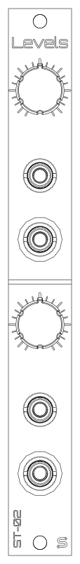

<picture>
  <source media="(prefers-color-scheme: dark)" srcset="docs/images/logo-light.png">
  
</picture>

# ST-02 Levels

A 3HP Eurorack dual passive attenuator from **Schenktronics**. Each channel has an input, an output, and a level knob, and the second input is normalled to the first, so one signal can go out at two different levels. No power needed.



## Features

- 3HP, 15 mm deep behind the panel (skiff-friendly), no power needed
- Two channels, each turning a signal down from full level to off
- In 2 is normalled to In 1: one input, two outputs at independent levels
- Works on audio, CV, gates, and bipolar signals
- All through-hole, 22 solder joints: a good first kit

## Documentation

| Document | For | PDF |
|----------|-----|-----|
| [User Manual](docs/manual.md) | Using the module | [PDF](docs/pdf/ST-02_Levels_User_Manual.pdf) |
| [Assembly Guide](docs/assembly-guide.md) | Building the kit | [PDF](docs/pdf/ST-02_Levels_Assembly_Guide.pdf) |
| [Bill of Materials](docs/BOM.md) ([CSV](docs/BOM.csv)) | Parts and sourcing | |

## Repository layout

```
hardware/
  ST-02_Levels.step            3D model of the assembled module
  levels/                      Main PCB (KiCad 5.1 schematic, KiCad 10 PCB)
    Levels.sch                   Schematic
    Levels.kicad_pcb             PCB layout
    Levels.step                  3D model
    BOM.ods                      Original BOM spreadsheet
  panel/                       Faceplate (KiCad 10, made as an aluminum PCB)
    LevelsFaceplate.kicad_pcb    Faceplate layout
    LevelsFaceplate.step         3D model
docs/                          Manual, assembly guide, BOM, images
  drawings/                      Scripts that generate the drawings
  pdf/                           PDF versions and their build settings
```

## Fabrication

| Board | Size | Layers | Thickness | Notes |
|-------|------|--------|-----------|-------|
| Main PCB | 15 x 100 mm | 2 | 1.6 mm | Standard green is fine |
| Faceplate | 15 x 128.5 mm | 1 | 1.6 mm | Aluminum PCB, white solder mask, black silkscreen. Only the front copper layer is used, so FR4 works too. |

## Sourcing your own parts

The [BOM](docs/BOM.md) lists every part. The jack pads are oval so the board can also take panel-mount style jacks, which may be easier to source.

## License

This hardware design and its documentation are licensed under [CC BY-NC-SA 4.0](https://creativecommons.org/licenses/by-nc-sa/4.0/). See [LICENSE](LICENSE).

The Schenktronics name and logo are trademarks of Nathan Schenk and are not covered by the CC BY-NC-SA 4.0 license.

## Links

- Shop: <https://schenktronics.com/product/st-02/>
- Docs page: <https://schenktronics.com/docs/st-02/>
- Tindie: <https://www.tindie.com/products/schenktronics/passive-attenuator/>
- ModularGrid: <https://modulargrid.net/e/schenktronics-atten>
- Build video: <https://www.youtube.com/watch?v=RKkGsIigaSM>
- Website: <https://schenktronics.com>
