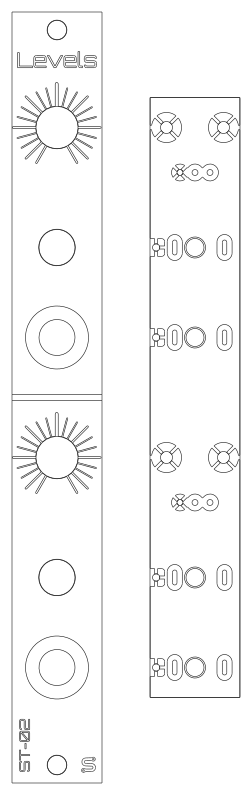
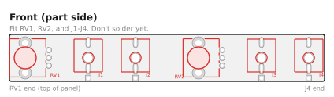
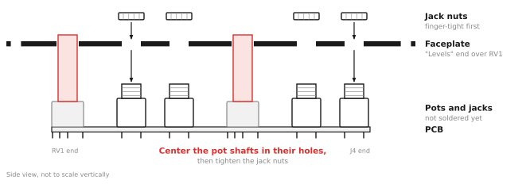
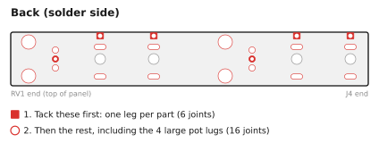
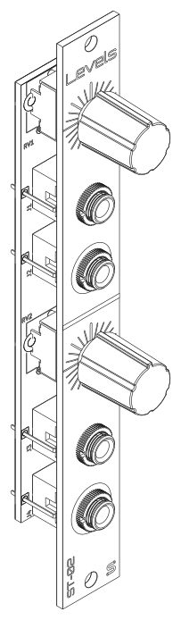

# ST-02 Levels: Assembly Guide

This kit takes about 20-30 minutes and 22 solder joints. There are no polarized parts, and the pots only fit one way, so it makes a good first Eurorack build.

**Prefer to watch?** There's a video of the whole build: [Watch me solder together a passive attenuator module!](https://www.youtube.com/watch?v=RKkGsIigaSM)

## What you need

### Kit contents

Check your kit against this list before you start (full details in the [BOM](BOM.md)):

- [ ] 1 x main PCB
- [ ] 1 x faceplate
- [ ] 4 x 3.5 mm jacks with nuts
- [ ] 2 x potentiometers
- [ ] 2 x knobs

### Tools

- Soldering iron (about 330-360 °C for leaded solder, a little hotter for lead-free)
- Solder: 0.8 mm, flux-core
- Safety glasses, since solder can spit
- Multimeter with continuity (beep) and resistance modes
- Small pliers (optional, for squaring up the jacks)
- Nut driver or wrench for the jack nuts (optional, but less likely to scratch the panel than pliers)

## Before you start

- The pots and jacks go on the **front** of the PCB, the side with the part outlines (RV1, RV2, J1-J4). The back is printed "ST-02 v1.1 / Levels", "schenktronics.com", and "CC BY-NC-SA 4.0", and that's the side you solder on.
- **Don't solder anything until the faceplate is on.** The pot shafts and jacks all pass through the faceplate, which holds them in line while you solder. Parts soldered first can end up crooked in their panel holes.

### First time soldering?

You only need the basics for this kit:

- Touch the iron to the pad and the pin at the same time, then feed solder into the joint, not onto the iron tip. A second or two is usually enough.
- A good joint is shiny and shaped like a small cone around the pin. A dull, lumpy blob usually means the pad didn't get hot enough. Reheat it, use some flux, and add a touch more solder if necessary.
- Keep the tip clean and lightly tinned. Wipe it on a damp sponge or brass wool between joints.
- Remember that solder flows toward the heat.
- Leaded solder (63/37 or 60/40 tin/lead) is easier to learn with than lead-free: it melts at a lower temperature and flows more easily. Lead-free works fine too, with a slightly hotter iron. Use whichever you prefer.
- If you use leaded solder, wash your hands when you're done, and don't eat, drink, or smoke while you're soldering. Wipe down your work surface afterward, and keep solder away from kids.
- Solder somewhere with some airflow, and keep your face to the side of the fumes, not right above them. The fumes primarily come from the flux, not the metals in the solder, but they can irritate your lungs.

## Step 1: Fit the pots and jacks

1. Push the two pots into RV1 and RV2 from the front of the PCB. Each pot only fits one way round: the three pins go in the row of three small holes, and the two mounting lugs go in the large holes. The lugs clip into the board and hold the pot in place.
2. Push the four jacks into J1-J4 from the front of the PCB. Make sure each one sits flat with all three legs through their holes.
3. Don't solder anything yet.

## Step 2: Fit the faceplate

1. Take the nuts off the jacks and set them aside. The pots have no nuts.
2. Lower the faceplate over the parts. The "Levels" label goes at the top, over RV1, and the pot shafts go through the two bigger holes.
3. Rubber bands or small spring clips can be helpful to hold the faceplate and the board together while you work.
4. Put the jack nuts back on and hand-tighten them for now.
5. Use a small pair of pliers to rotate the jack bodies as necessary to align them squarely with each other. This step is optional, but a nice touch.
6. Check that each pot shaft is centered in its hole, and that the PCB is parallel to the faceplate. The shafts are thinner than their holes, and only the solder will hold them, so centering them now stops the knobs rubbing later. The legs have a little play in their holes, which gives you room to adjust.

## Step 3: Solder the pots and jacks

Turn the whole thing over and solder from the back of the PCB.

1. Tack one leg of each part: the square pad of each jack, and the middle pin of each pot. Then check again that the pot shafts are still centered. If one isn't, reheat that joint and adjust.
2. Solder the remaining pins and pads.
3. Solder the four large mounting-lug pads of the pots. They connect to the ground plane, so they take a little longer to heat. Hold the iron on until the solder flows into the hole.
4. Snug the nuts down. Don't overtighten: it can strip the jack threads or damage the panel.

Look over every joint before moving on. Each should be shiny and cone-shaped, with no solder bridging neighboring pads.

## Step 4: Fit the knobs

Push each knob onto its pot shaft. The flat on the shaft sets the knob's position, so there's nothing to line up. Check that each knob turns without rubbing on the panel.

## Step 5: Test

Use a multimeter. No power is needed. The easiest way to reach a jack's tip and sleeve is to plug in a patch cable and probe its plug. "Beep" means continuity mode, and "Ω" means resistance mode.

| Test | Expected result |
|------|-----------------|
| Sleeve of any jack <-> sleeve of every other jack | Beep |
| In 1 tip <-> Out 1 tip, Level 1 fully clockwise | Beep, or a few ohms |
| Out 1 tip <-> sleeve, Level 1 fully counterclockwise | Beep, or a few ohms |
| In 2 tip <-> Out 2 tip, Level 2 fully clockwise | Beep, or a few ohms |
| Out 2 tip <-> sleeve, Level 2 fully counterclockwise | Beep, or a few ohms |
| Cable in In 1 only: In 1 tip <-> Out 2 tip, Level 2 fully clockwise | Beep (the normal is working) |
| Same, with a second cable plugged into In 2 | **No beep** (the normal is broken) |
| In 1 tip <-> sleeve, nothing in In 2 (Ω) | About 50 kΩ (both pots in parallel). **Near 0 Ω means a short:** look for a solder bridge. |
| In 2 tip <-> sleeve, cable in In 2 (Ω) | About 100 kΩ. **Near 0 Ω means a short.** |

## Step 6: Install

Mount the module in your case with two M3 screws. How to use it is in the [User Manual](manual.md).

## Troubleshooting

| Symptom | Likely cause |
|---------|--------------|
| One jack is dead | A cold or missing joint on that jack. Reflow all three of its legs. |
| Out 2 is silent with a cable in In 1 and nothing in In 2 | The normalling contact on J3 (In 2) isn't soldered well. Reflow all three J3 legs. |
| A knob does nothing, or the output jumps | A bad joint on that pot. Reflow its three pins. |
| A signal is shorted to ground | A solder bridge between a tip pad and a ground pad or lug. |
| A knob rubs on the panel | It's pushed on too far. Pull it out slightly. |
| A pot shaft is crooked in its hole | It wasn't centered before soldering. Reheat the pot's pins and lugs, and straighten it. |
| Full level is a little quieter than the input | That's normal for a passive attenuator. See [Good practice](manual.md#good-practice) in the manual. |
