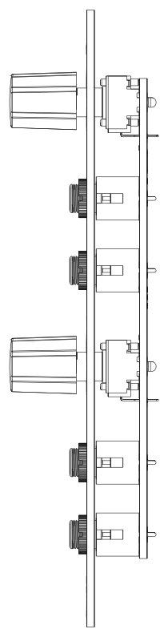
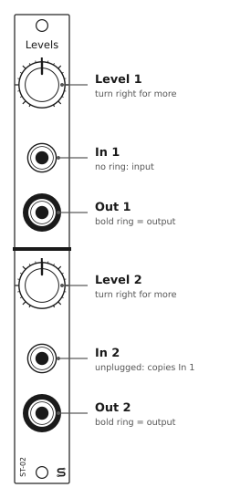

# ST-02 Levels: User Manual

## Overview

Levels is a 3HP dual attenuator. Each channel takes the signal at its input and gives you a smaller copy at its output, set by its knob. In 2 is normalled to In 1, so one signal can feed both channels at different levels.

There's nothing on the board but jacks and pots, so it doesn't need power.

## Specifications

| | |
|---|---|
| Format | Eurorack, 3HP |
| Panel | 15 x 128.5 mm |
| Depth | 15 mm behind the panel (skiff-friendly) |
| Power | None |
| Jacks | 4 x 3.5 mm mono (TS): 2 inputs, 2 outputs |
| Controls | 2 x level knobs, 100 kΩ linear potentiometers |
| Range | Off (fully counterclockwise) to full level (fully clockwise). It can't amplify or invert. |
| Signals | Audio, CV, gates, and both unipolar and bipolar signals |

## Panel layout

The panel has two identical channels, separated by the thick line. In each channel the knob is at the top. Below it, the nearer jack is the **input** (unmarked), and the farther jack is the **output**, marked with a **bold ring**.

## Using the module

### Level knobs

Turn a knob clockwise for more signal. Fully counterclockwise, the output is at 0 V (off). Fully clockwise, it's close to the full input signal. It's never bigger than the input, because there's no amplifier.

The knob scales the signal toward 0 V. A bipolar LFO swinging ±5 V becomes a smaller swing around 0 V. It isn't shifted or offset.

### Normalled input

In 2 is normalled to In 1. With nothing plugged into In 2, channel 2 gets its signal from In 1. Plug a cable into In 2 to break the normal and use the channels separately.

So with one cable into In 1:

- **Out 1** gives the signal at the Level 1 setting.
- **Out 2** gives the same signal at the Level 2 setting.

That's a quick way to send one modulation source to two places at different depths.

### Using it on audio

On audio, an attenuator is a volume control. Use it to bring a hot oscillator down before a filter or effect, or to set a level going into a mixer that has no level controls.

## Patch examples

Each drawing shows the module sending the signal on the left and the modules receiving it on the right.

### Set the depth of an LFO

Plenty of filter CV inputs have no attenuator, so a full-size LFO sweeps the filter from closed to wide open. Patch the LFO through channel 1 and use Level 1 to set how far it sweeps.

### One LFO at two depths

Leave In 2 empty and the LFO reaches both channels. Here Level 1 sets how much the filter moves, and Level 2 sets how much the pulse width moves, all from one cable.

### Two separate attenuators

With a cable in In 2, the channels are independent. Here channel 1 sets how far an envelope opens a VCA, and channel 2 turns a VCO down before a mixer.

## Good practice

- **Patch sources into the inputs.** Plug sources into the In jacks (unmarked), not the Out jacks (bold ring). A source patched into an Out jack is wired straight to the knob's wiper, so the knob won't work the way you expect, and turning it fully counterclockwise connects that source directly to ground. Most Eurorack outputs are protected against this, but not all of them are.
- **Full level is slightly below the input.** A passive attenuator loads both the module feeding it and the module it feeds. With typical Eurorack modules, fully clockwise gives a little less than the original signal, and the middle of the knob gives a bit less than half. That's normal for any passive attenuator. If you need exact levels, use a buffered attenuator.
- **Pitch CV (V/oct).** Attenuating a pitch CV changes the intervals, so the oscillator won't track in tune. It won't transpose.
- **One source into both channels.** When In 2 is empty, In 1 feeds both knobs, so it loads the source a little more. With most modules it makes no difference.
- **Grounds.** The sleeves of all four jacks are wired together.

## Installation

1. Turn your case off. This module doesn't need power, but you shouldn't be working in a powered case anyway.
2. Put the module in any free 3HP space. There's no ribbon cable to connect.
3. Fix it in place with two M3 rack screws. Don't overtighten them.

## Circuit

Each channel is one potentiometer wired as a voltage divider. The input jack's tip goes to one end of the pot, the other end goes to ground, and the wiper goes to the output jack's tip. In 2 (J3) is a switched jack. Its normalling contact is wired to the tip of In 1 (J1), so In 1 feeds channel 2 until a plug goes into In 2. All the sleeves and the pots' mounting lugs are wired to ground. The schematic is in [hardware/levels/Levels.sch](../hardware/levels/Levels.sch) (KiCad 5).
